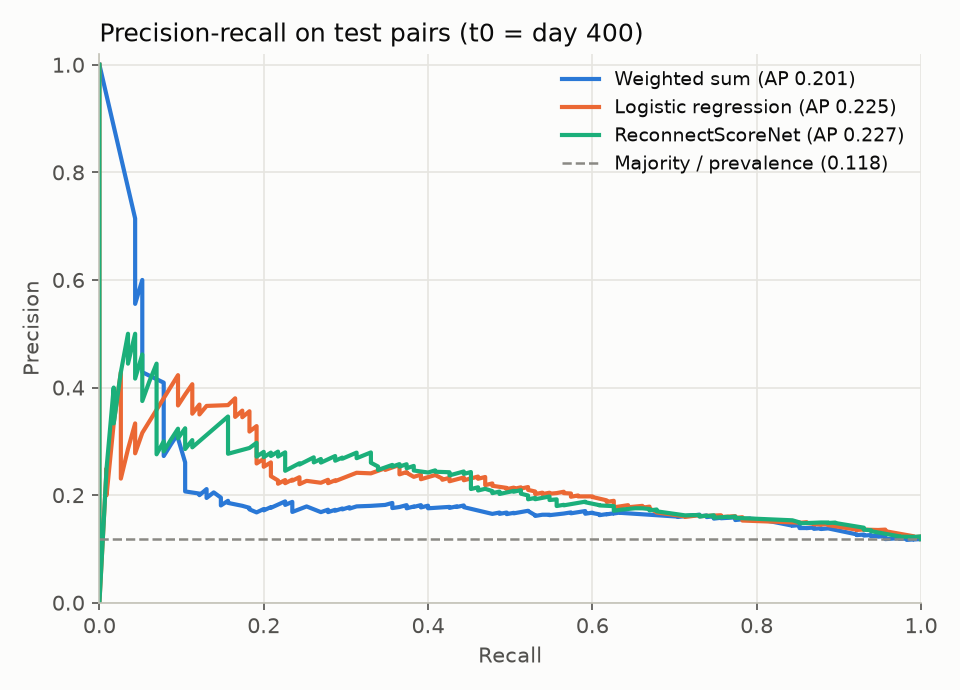

# Ranking Dormant Ties in a Timestamped Email Network

**Phase 2 — Mid-Project Report**
CSC 4740/6740 Data Mining
Team 3 - Undergraduate
Cinthia Ochoa Torre
October 27, 2026

## 1. Project's Current Update

The full pipeline from the Phase 1 proposal runs end to end on the SNAP files: data audit,
node alignment, the pair table, the four signals, the Reconnect Score, the three comparison
procedures, ReconnectScoreNet, the ablation, the error analysis, the one-sender case study,
and the out-of-time check. One command (`python src/run_all.py`) rebuilds every number in
this report in under a minute on a laptop.

Two problems in the data forced changes to the plan. Section 3.2 lists every departure from
the proposal.

- **The department labels use a different node numbering from the temporal edge list.** A
  direct join would have attached the wrong department to almost every person. I recovered
  the correct mapping by graph alignment and verified it on every edge (Section 1.2).
- **The trace has no email between day 525.5 and day 797.3.** The proposed decision time
  (day 600) falls inside that silence, so its label window is empty. The decision times
  move to day 400 (main) and day 460 (out-of-time), chosen by a rule that does not look at
  labels (Section 1.3).

### 1.1 Data

| Quantity | Value |
|---|---|
| Emails in the temporal file | 332,334 |
| Self-mail removed | 0 |
| People in the temporal file | 986 |
| People with a verified department | 965 (21 unresolved) |
| Departments | 42 |
| Last email in the contiguous record | day 525.5 |
| Emails after the gap (days 797.3–803.9) | 2,424 (never used) |

### 1.2 Node-ID alignment

SNAP publishes the department labels with the static release (email-Eu-core). The temporal
release numbers people differently. Joining the two files on the integer ID, only 571 of the
24,929 directed temporal edges appear in the static graph, while a random relabeling gives
638: the naive join is no better than chance. With self-loops removed, however, the static
graph has exactly 24,929 directed edges, the same as the collapsed temporal graph, so the two
should be the same graph under different labels.

The crosswalk is built with joint color refinement (1-dimensional Weisfeiler–Leman) on both
directed graphs, followed by individualization and refinement until the match is one-to-one.
The resulting mapping carries all 24,929 of 24,929 temporal edges onto static edges.

954 people are identified uniquely. The other 32 fall into 14 small groups of structural
twins (two to four people with identical connection patterns) that no method using the graph
alone can tell apart. In 5 of those groups every member has the same department, so 11 more
people get a safe department. The remaining 21 people keep an unresolved department, and, as
the proposal specifies, any pair that includes one of them gets S = 0. This affects 13 of the
6,480 dormant pairs.

### 1.3 Decision times

Emails per 30 days are steady (7,000–26,000) from day 0 to day 525, then drop to zero until a
7-day burst at day 797. SNAP's "803 days" counts the gap.

The rule: t₀ is the latest multiple of 10 for which both label windows end inside the
contiguous record, t₀ + 2 × 60 ≤ 525.5. That gives t₀ = 400 and an out-of-time decision time
of 460, with label windows (400, 460] and (460, 520]. The 90-day gate and the 60-day horizon
are unchanged. The pipeline checks the rule and stops if a label window runs past the record.

### 1.4 Pair counts and class balance

| | t₀ = 400 | t₀ = 460 (out-of-time) |
|---|---|---|
| Pairs with an email at or before t₀ | 13,195 | 14,462 |
| Excluded by the 90-day gate (still active) | 6,715 | 6,612 |
| Dormant pairs | 6,480 | 7,850 |
| Resumed within 60 days | 769 (11.9%) | 1,215 (15.5%) |
| Mutual history (C = 80) | 2,620 | 3,362 |
| One-way history (C = 40) | 3,860 | 4,488 |

The dormant pairs at t₀ = 400 are split at random, stratified on the label, into 4,536 train
(538 resumptions), 972 validation (116) and 972 test (115). Resumptions are rare (about 1 in
8), so the results lead with precision, recall, average precision and the precision–recall
curve, as planned.

### 1.5 Signals

The four signals follow Section 3.3 of the proposal; the data dictionary in the repository
gives the exact definitions. Every signal was checked to lie in 0–100. Closeness bin edges,
fit on the training pairs and frozen: 1–2 emails → 20, 3–4 → 35, 5–7 → 60, more than 7 → 90.

| Signal | Mean | Median | Resumption rate across levels (training pairs) |
|---|---|---|---|
| S, similarity | 48.8 | 40 | rises from 5.9% (S = 0) to 18.1% (S = 100) |
| H, closeness | 35.2 | 20 | rises from 8.5% (H = 20) to 20.1% (H = 90) |
| C, history | 56.2 | 40 | 9.5% one-way vs 15.3% mutual |
| T, overdue | 84.4 | 100 | falls from 17.9% (T ≤ 25) to 10.4% (T = 100) |

S, H and C move in the direction the proposal assumed. T does not. The proposal treated a
longer silence as more "overdue" for contact; in this data a longer silence means the tie is
more likely to be over. 63% of dormant pairs sit at the T = 100 cap (silent at least 180 days).

## 2. Results Obtained

### 2.1 Test pairs, t₀ = 400

Thresholds for every procedure except the majority class are chosen on the validation pairs
by maximum F1. ROC-AUC and average precision do not depend on a threshold.

| Procedure | Acc. | Prec. | Recall | F1 | ROC-AUC | AP | Brier |
|---|---|---|---|---|---|---|---|
| Majority class | 0.882 | 0.000 | 0.000 | 0.000 | 0.500 | 0.118 | 0.104 |
| Weighted sum, s ≥ 48 (first pass) | 0.455 | 0.155 | 0.809 | 0.260 | 0.630 | 0.201 | 0.291* |
| Weighted sum, s ≥ 41.7 (validation) | 0.341 | 0.138 | 0.870 | 0.238 | 0.630 | 0.201 | 0.291* |
| Logistic regression (L2) | 0.736 | 0.218 | 0.478 | 0.300 | 0.676 | 0.225 | 0.100 |
| ReconnectScoreNet (4–16–8–1) | 0.718 | 0.205 | 0.478 | 0.287 | 0.676 | 0.227 | 0.100 |

\* The weighted sum is a ranking score, not a probability. Its Brier score uses s / 100 and is
shown only for completeness.

ReconnectScoreNet and logistic regression tie. Over five training seeds the network scores
ROC-AUC 0.677 ± 0.002 and average precision 0.229 ± 0.008, so the tie is not a seed effect.
Both learned models beat the weighted sum, and all three beat the majority baseline. The
validation-tuned cutoff for the weighted sum (41.7) is lower than the first-pass cutoff (48);
on test the first-pass cutoff has the better F1. Both are reported, as planned.

### 2.2 Out-of-time check, t₀ = 460

The same fitted models and thresholds are applied to the 7,850 dormant pairs at day 460.
Nothing was tuned on these pairs.

| Procedure | Prec. | Recall | F1 | ROC-AUC | AP | Brier |
|---|---|---|---|---|---|---|
| Majority class | 0.000 | 0.000 | 0.000 | 0.500 | 0.155 | 0.132 |
| Weighted sum, s ≥ 48 | 0.182 | 0.735 | 0.292 | 0.602 | 0.216 | 0.293* |
| Logistic regression (L2) | 0.263 | 0.515 | 0.348 | 0.669 | 0.285 | 0.125 |
| ReconnectScoreNet | 0.252 | 0.537 | 0.343 | 0.670 | 0.292 | 0.125 |

The order of the procedures is the same as at day 400. ROC-AUC drops by less than 0.01 for the
learned models and by 0.03 for the weighted sum. Precision and AP are higher because the base
rate is higher (15.5%).

Pairs dormant at day 460 can also appear in the day-400 training fold. This does not leak
labels: a pair dormant at day 460 sent no email in (370, 460], so its day-400 label was 0.

### 2.3 Ablation

Each signal is dropped in turn. For the weighted sum its term is removed; logistic regression
and the network are refit on the other three signals. "Top partner changed" is the share of
100 randomly sampled people (each with at least three dormant partners) whose highest-ranked
dormant partner changes.

| Dropped | ΔAP weighted sum | ΔAP logistic | ΔAP network | Top changed (sum) | Top changed (network) |
|---|---|---|---|---|---|
| S | −0.037 | −0.025 | −0.019 | 33% | 24% |
| H | −0.049 | −0.030 | −0.029 | 51% | 50% |
| C | −0.013 | +0.001 | −0.002 | 14% | 19% |
| T | +0.005 | −0.013 | −0.013 | 32% | 37% |

Closeness carries the most signal, then similarity. History adds almost nothing once the
others are present, since a mutual thread is usually also a longer thread. Removing Overdue
improves the weighted sum, because its positive weight pushes the longest-silent pairs up. The
learned models give T a negative weight (logistic coefficient −0.33, against +0.68 for S and
+1.24 for H), which is why dropping T hurts them.

### 2.4 Error analysis

The planned check targets false positives with high overdue and near-zero similarity
(T ≥ 75 and S ≤ 20): pairs that silence alone would rank high.

| Procedure | False positives on test | With T ≥ 75 and S ≤ 20 | Share |
|---|---|---|---|
| Weighted sum (validation cutoff) | 626 | 66 | 10.5% |
| ReconnectScoreNet | 214 | 15 | 7.0% |

This pattern covers 26.5% of all test negatives, so both procedures flag it far less often
than its base rate: the similarity signal does hold these pairs down. The weighted sum's
larger problem is the number of false positives. Its cutoff must be low to reach a useful
recall, and the T term lifts long-dead ties above that cutoff.

### 2.5 Case study

The case-study sender is person 16: 188 emails sent before day 400, the closest to the median
(187) among people with at least 8 dormant partners. Person 16 has 35 dormant partners at day
400, and 5 of them wrote again within 60 days. The full 35-row table is in the repository
(reports/case_study_sender.csv). The top five by Reconnect Score:

| Rank | Partner | Same dept. | Emails 16→p / p→16 | Days silent | S | H | C | T | Score | P(net) | Resumed |
|---|---|---|---|---|---|---|---|---|---|---|---|
| 1 | 249 | yes | 4 / 8 | 159.4 | 60 | 90 | 80 | 77.2 | 74.9 | 0.216 | no |
| 2 | 502 | no | 1 / 2 | 364.6 | 80 | 35 | 80 | 100.0 | 72.8 | 0.117 | no |
| 3 | 724 | yes | 2 / 2 | 271.6 | 80 | 35 | 80 | 100.0 | 72.8 | 0.117 | no |
| 4 | 423 | yes | 2 / 5 | 175.7 | 60 | 60 | 80 | 95.2 | 71.0 | 0.142 | no |
| 5 | 832 | no | 4 / 5 | 133.7 | 60 | 90 | 80 | 48.5 | 69.2 | 0.253 | yes |

Partners 502 and 724 show the Overdue problem directly: a year-long silence after three or four
emails puts them second and third under the weighted sum, while the network ranks them tied at
16th of 35.

**Hand check.** Three rows (ranks 1, 18 and 35) were recomputed from the raw file by a separate
routine that uses only the Python standard library. All S, H, C, T and score values match the
pipeline exactly.

**Stability.** At day 460, four of person 16's top five at day 400 are still dormant, and all
four are still in the top five. Across all 707 people whose top partner at day 400 is still
dormant at day 460, 66% keep the same top partner.

### 2.6 Interpretation so far

- The four signals carry real but modest information: the best ROC-AUC is about 0.68.
- The network only ties logistic regression. As the proposal anticipated, four tabular signals
  with a roughly monotone relationship to the label need no deeper model.
- The hand-weighted score trails the learned models for a specific reason: Overdue enters with
  the wrong sign.

## 3. Progress Compared to the Milestones

### 3.1 Status by task

The Phase 1 schedule set four tasks. The first three are complete; the case study was finished
ahead of its November 1 checkpoint.

| Task | Planned dates | Planned work | Status |
|---|---|---|---|
| 1. Data | Sep 21 – Oct 4 | Download files, check ID alignment, build pair table and 30-day profiles, data dictionary, fix t₀, gate and horizon, record counts | Complete. ID check failed and was resolved with a verified crosswalk; t₀ moved to day 400 |
| 2. Model | Oct 5 – Oct 18 | Majority, weighted-sum and logistic baselines and ReconnectScoreNet; tune threshold on validation; four ablations; seven metrics | Complete |
| 3. Case study | Oct 19 – Nov 1 | Scored table for one sender; recompute three rows by hand; repeat ranking at second decision time | Complete, ahead of schedule. Hand check matches the formula on all three rows |
| 4. Evaluation and report | Nov 2 – Nov 20 | Error analysis, methodology, metric table, case study write-up, recorded walkthrough | Started. Error-analysis counts and tables are computed; the write-up and video remain |

The proposal also set a contingency: if the network only ties logistic regression, that result
stands. It does, and the result is reported as is. The second contingency (lengthening the label
horizon if almost nobody resumes contact) was not needed, since 11.9% of dormant pairs resume.

### 3.2 Departures from the proposal

| Proposal | Now | Reason |
|---|---|---|
| Check that node IDs align, then join | Crosswalk recovered by graph isomorphism; 21 people unresolved | IDs do not align; the naive join is no better than chance |
| t₀ ≈ 600, second t₀ = 660 | t₀ = 400, second t₀ = 460 | No email between day 525.5 and day 797.3 |
| Trace of 803 days | Contiguous record of 525.5 days | Same gap |
| S defined from the sender's side | S = maximum over both directions | Pairs are unordered; both directions are kept in the data |
| Closeness bins from training quantiles | Tertiles of counts above 2 on training pairs: 3–4, 5–7, more than 7 | Makes "quantiles" concrete; one or two emails stay at 20 |
| Random 70/15/15 split | Same, stratified on the label | Keeps the rare positive class balanced across folds |
| Validation threshold for the weighted sum | Same rule (maximum F1) for logistic regression and the network | One rule for every procedure |
| 4–16–8–1 network | Same, with hidden biases initialized to 0.1 | With default initialization one of five seeds collapsed to a constant output |

## 4. Future Work

The remaining work fits in Task 4 (November 2 – November 20).

- **Error analysis write-up (Nov 2 – Nov 8).** Describe the high-overdue, low-similarity false
  positives with examples, and the larger group of weighted-sum false positives that the T term
  lifts above the cutoff.
- **Post-hoc Reconnect Score (Nov 2 – Nov 8).** Report a variant with weights refit on the
  training pairs and one with T reversed (rewarding a shorter silence). Both will be labeled
  post-hoc and shown next to the pre-specified score, which stays unchanged in the main table.
- **Per-sender ranking metric (Nov 9 – Nov 13).** The project ranks partners for one sender at a
  time, so the final report will add how often each procedure's top-ranked partner is one that
  resumes contact, averaged over senders.
- **Final report and walkthrough (Nov 9 – Nov 20).** Methodology, the final metric tables, the case
  study, and a recorded walkthrough of the SNAP tables, the four signals and the model comparison.
